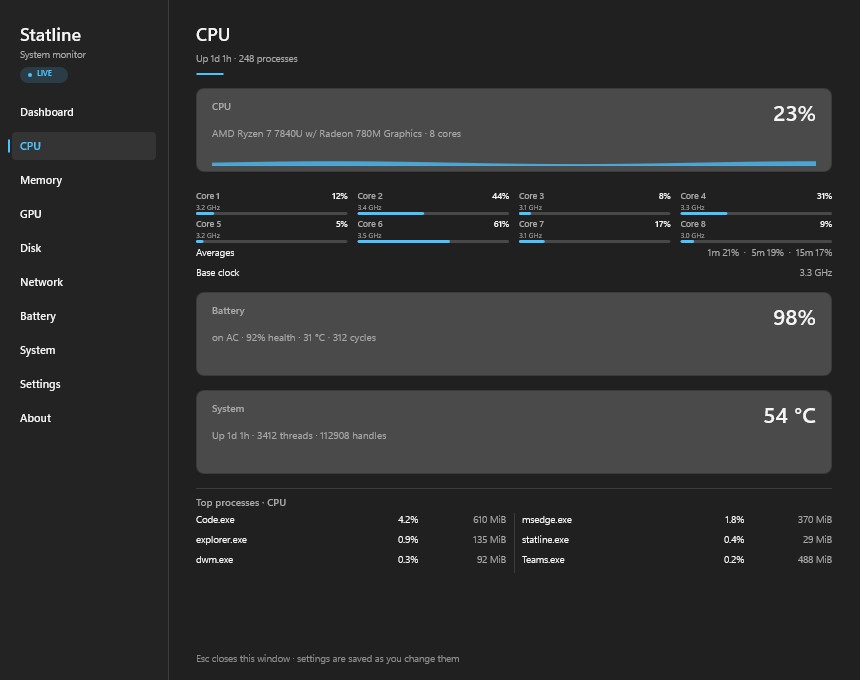

<div align="center">


# StatLine

**A system monitor that lives in your Windows 11 taskbar.**

CPU, memory, GPU, disk and network in a 240-pixel strip. Native Rust, no Electron.

[](https://www.rust-lang.org)
[](https://www.microsoft.com/windows/windows-11)
[](LICENSE)
[](PRIVACY.md)

</div>

<p align="center">
  
</p>

## Why

Most taskbar monitors are either an Electron app idling at 150 MB, or a widget that
needs a kernel driver to read a temperature. StatLine is neither: one 680 KB executable
using the Windows performance counters and nothing else.

## Features

- **Taskbar strip** — CPU, memory, GPU, disk and a two-line network readout, anchored
  beside the tray. It is a real child of `Shell_TrayWnd`, so the Start menu cannot cover
  it and clicking it never steals focus.
- **Flyout** — click a segment for that module alone: per-core clocks, commit and cache,
  VRAM, per-volume capacity, per-adapter rates.
- **Companion window** — a normal resizable window with a page per module and a
  remembered position.
- **Sensors without a driver** — ACPI thermal zone, drive temperature, battery health and
  cycle count, Wi-Fi SSID and signal, and GPU telemetry via NVML or ADL when the driver
  exposes it. Anything unavailable is hidden, never faked.
- **Per-app detail** — CPU and GPU share per process, grouped by executable. Sampling runs
  only while a surface that shows it is open.
- **Yours to configure** — theme, seven accent colours, interval, binary or decimal units,
  °C or °F, strip density, module order, Mica backdrop, start with Windows.

<table>
<tr>
<td></td>
<td></td>
</tr>
<tr>
<td></td>
<td></td>
</tr>
</table>

## Install

Download `StatLine-<version>-x64.zip` from [Releases](../../releases), unpack it anywhere,
and run `statline.exe`. No installer, no administrator rights, no runtime to install.

To start with Windows, enable **Start with Windows** in Settings — it writes a per-user
`Run` value. Verify or remove it from a console:

```powershell
statline.exe --startup-status
statline.exe --remove-startup
```

## Build

Requires Windows 11, Rust MSVC 1.85+ and the Visual Studio C++ build tools (for
`link.exe`). Details in [`docs/ops/build.md`](docs/ops/build.md).

```powershell
cargo build --release
.\target\release\statline.exe
```

Before sending a patch:

```powershell
cargo fmt --all -- --check
cargo clippy --all-targets -- -D warnings
cargo test --all
cargo deny check
```

## Privacy

No network access. No telemetry, no analytics, no update check. No kernel driver and no
elevated helper.

| | |
|---|---|
| **Reads** | Performance counters, PDH, DXGI, storage and battery IOCTLs, WLAN SSID, SMBIOS, and read-only registry (theme, CPU name, Windows build) |
| **Writes** | `%APPDATA%\StatLine` (settings), `%LOCALAPPDATA%\StatLine\logs`, and an optional per-user `Run` value |
| **Never** | Admin/UAC, network, telemetry, drivers or services, clipboard, input, screen or document access |

The full read/write table is in [`docs/ACCESS.md`](docs/ACCESS.md); the policy is in
[`PRIVACY.md`](PRIVACY.md).

## What it deliberately does not do

- **No CPU package temperature or fan RPM.** Windows has no user-mode API for these;
  reading them needs a kernel driver, which is out of scope for a taskbar utility.
- **No network of any kind.** Not even an update check.
- **No code copied from other monitor projects.** Win32 usage is written from the public
  API documentation.

## Contributing

Issues and pull requests are welcome. Read [`AGENTS.md`](AGENTS.md) first — it describes
the resource budget, the `unsafe` rules and the verification gate. The short version:
things must stay fast, and a claim about Windows behaviour needs the API named.

## Licence

MIT — see [`LICENSE`](LICENSE). Third-party notices are in
[`THIRD_PARTY_NOTICES.md`](THIRD_PARTY_NOTICES.md).
