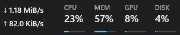
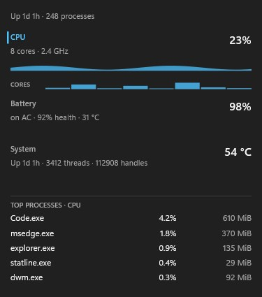
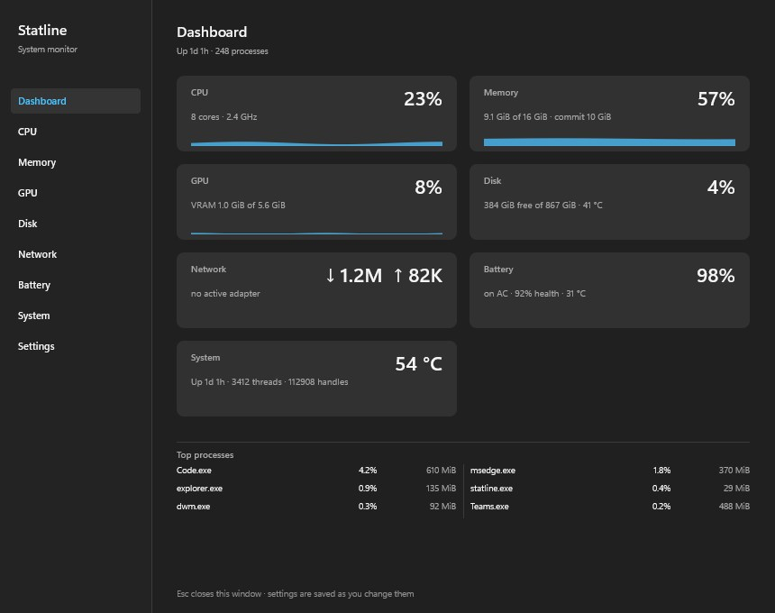
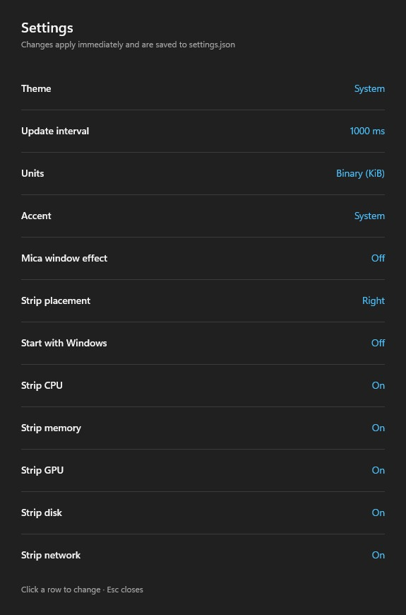

# Statline


A live system monitor that lives in the Windows 11 taskbar. Native Rust + Win32 +
Direct2D — no Electron, no WebView, no driver, no telemetry, no network access.



> **Status: 0.1.0 preview.** The strip, flyout, companion window, settings and
> driver-free sensors work. See [`docs/STATUS.md`](docs/STATUS.md) for the exact state
> and [`CHANGELOG.md`](CHANGELOG.md) for what shipped.

## What it does

- **Strip in the taskbar**: CPU, memory, GPU, disk and a two-line network readout,
  anchored beside the tray (or the leftmost free area on a centred taskbar). It is a
  real child of `Shell_TrayWnd`, so the Start menu no longer covers it, and clicking it
  never steals focus.
- **Flyout**: clicking a segment opens just that module — CPU shows per-core bars and
  the CPU process table, Memory shows commit/cache and the top memory apps, Disk and
  Network add per-volume and per-adapter rows. System and Battery stay visible.

  
- **Companion window**: a normal resizable Windows 11 window with a left navigation —
  Dashboard, CPU, Memory, GPU, Disk, Network, Battery, System, Settings and About — a
  detail page for each module, and remembered position/size.

  

- **Settings**: theme (system/light/dark), seven accent presets, sampler interval, byte
  units, Celsius/Fahrenheit, strip placement, start-with-Windows, per-module strip
  visibility and an optional Mica window effect (with a GPU/battery caution). Changes
  apply live and are written atomically.

  

- **Sensors without a driver**: ACPI "System" temperature, drive temperature, battery
  health/temperature, GPU temperature/fan/power/clocks via NVML (NVIDIA) or ADL
  (AMD), and Wi-Fi SSID/signal, when the installed driver exposes them. Anything
  unavailable is hidden, never faked.
- **Per-app detail**: process CPU is a share of total capacity (the Task Manager scale),
  with working set; instances of the same executable are grouped. The GPU page lists the
  apps using the GPU with their share of engine time, read from the PID inside each
  `\GPU Engine(*)` instance — no vendor SDK and it works on an integrated GPU. Sampling
  only runs while a surface showing processes is open.
- **Disk and network**: per-volume capacity/temperature, per-physical-disk activity and
  each drive's model and bus (`NVMe SAMSUNG MZVLQ512HALU-00000`), adapter rates and link
  speed, and the Wi-Fi SSID/signal when connected.
- **System**: Windows build, computer name, and each memory slot's capacity, DDR
  generation and speed from SMBIOS.

## Access and permissions

Statline runs as a standard user. It never requests elevation, installs a driver or
service, or opens a network connection.

| | |
|---|---|
| **Reads** | CPU/memory/disk/network/GPU performance counters, PDH, DXGI, storage/battery IOCTLs, WLAN SSID, and read-only registry (theme, CPU name, Windows build) |
| **Writes** | `%APPDATA%\Statline\settings.json`, `window.json`, `%LOCALAPPDATA%\Statline\logs`, and an optional per-user `Run` value |
| **Never** | Admin/UAC, network, telemetry, drivers/services, clipboard, input, screen, or document access |

Startup is optional and per-user, with no elevation:

```powershell
statline.exe --startup-status   # exact command + whether it matches this build
statline.exe --remove-startup  # delete the Run value
```

The first launch shows a one-time access notification. The full read/write table is in
[`docs/ACCESS.md`](docs/ACCESS.md), the policy in [`PRIVACY.md`](PRIVACY.md), and the
release process in [`docs/PUBLISHING.md`](docs/PUBLISHING.md).

## Privacy and footprint

- No network access, no telemetry, no update check, no analytics.
- No kernel driver, no elevated helper, no third-party runtime.
- Writes only to `%APPDATA%\Statline` (settings), `%LOCALAPPDATA%\Statline` (logs), and
  the per-user `Run` key when you enable "Start with Windows".
- Idle cost measured on a Ryzen laptop: **0.46 ms CPU per 1 s sample** with detail
  surfaces closed, ~30 MB working set / ~14.5 MB private with the strip live.
  See [`docs/ops/perf-budget.md`](docs/ops/perf-budget.md).

## Install (portable)

1. Build or unpack `Statline-<version>-x64.zip`.
2. Run `statline.exe`. It starts in the notification area and attaches the strip.
3. Right-click the strip or the tray icon for Settings, Dashboard, Pause and Exit.

The portable build needs no installer and no administrator rights. Build the MSIX
package with `scripts/build-msix.ps1` if you need a packaged deployment; it declares
`runFullTrust` and a user-toggleable startup task.

## Build

Requirements: Windows 11, the Rust MSVC toolchain, and the Visual Studio C++ build tools
(for `link.exe`). See [`docs/ops/build.md`](docs/ops/build.md).

```powershell
$env:Path = "$env:USERPROFILE\.cargo\bin;$env:Path"
cargo build --release
.\target\release\statline.exe
```

Verification (the same checks CI runs):

```powershell
cargo fmt --all -- --check
cargo clippy --all-targets -- -D warnings
cargo test --all
cargo build --release
```

Package a portable zip:

```powershell
powershell -ExecutionPolicy Bypass -File .\scripts\package.ps1 -Version 0.1.0
```

Debug and measurement modes:

```powershell
.\target\release\statline.exe --probe          # live values, top processes, exit
.\target\release\statline.exe --bench 60       # sampling cost + memory
.\target\release\statline.exe --profile 200    # per-provider cost
.\target\release\statline.exe --render-snapshots .\snapshots-out
.\target\release\statline.exe --tray-only
```

Logs: `%LOCALAPPDATA%\Statline\logs\statline.log` (1 MB, three rotations).

## What it deliberately does not do

- No CPU package temperature or fan RPM: Windows has no user-mode API, and shipping a
  driver is out of scope. GPU vendor telemetry is best effort: NVML/ADL only when the
  installed driver exposes it. GPU utilization and VRAM work through the Windows
  performance counters.
- No network requests of any kind.
- No code from other monitor projects; Win32 usage is implemented from the public API
  documentation.

## Documentation

Everything lives in [`docs/`](docs/INDEX.md), indexed by task. Start with
[`docs/STATUS.md`](docs/STATUS.md), then the ADRs under [`docs/adr/`](docs/adr/).

## Licence

MIT. Third-party notices and the Apache/MIT texts are in
[`THIRD_PARTY_NOTICES.md`](THIRD_PARTY_NOTICES.md) and [`licenses/`](licenses/).
